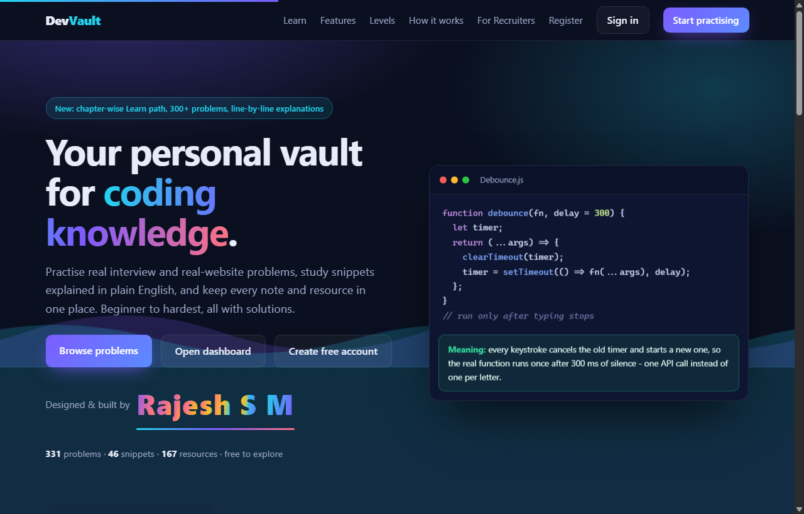
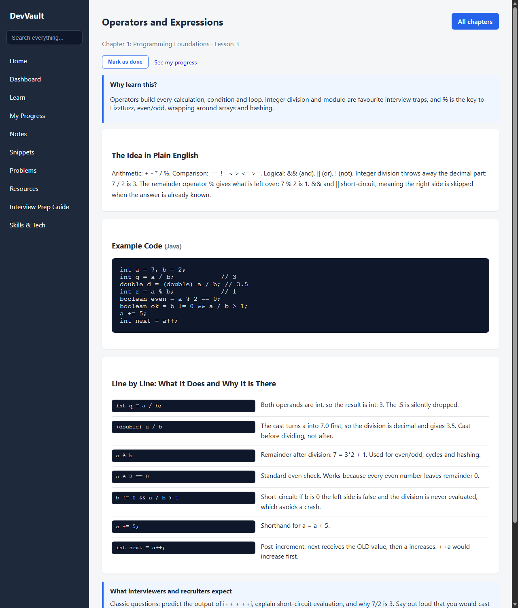
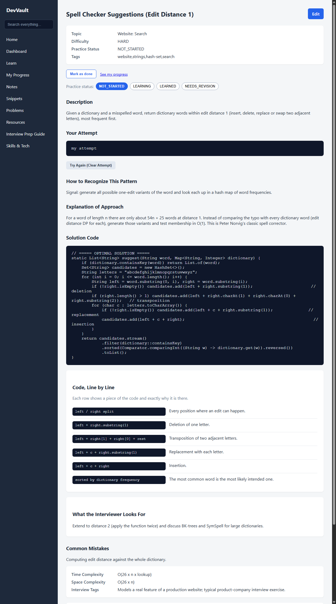
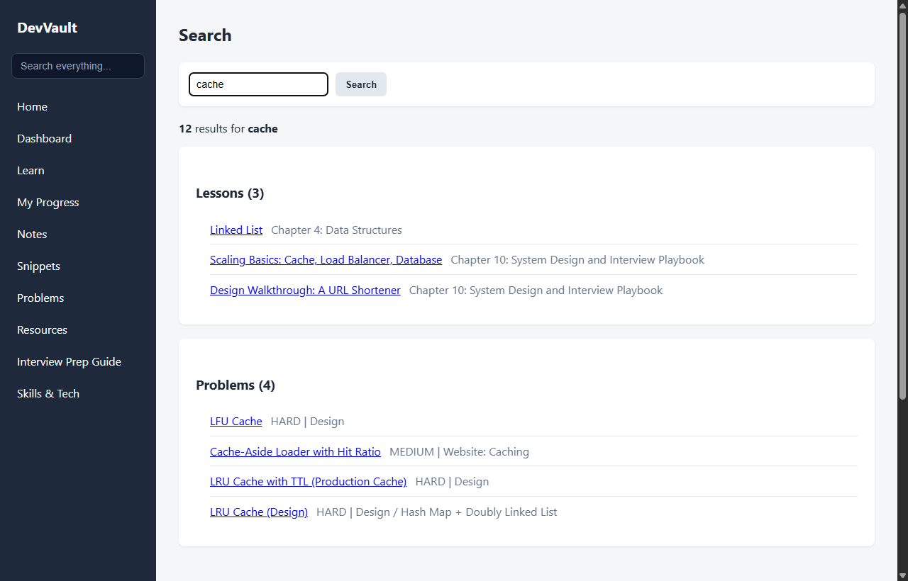
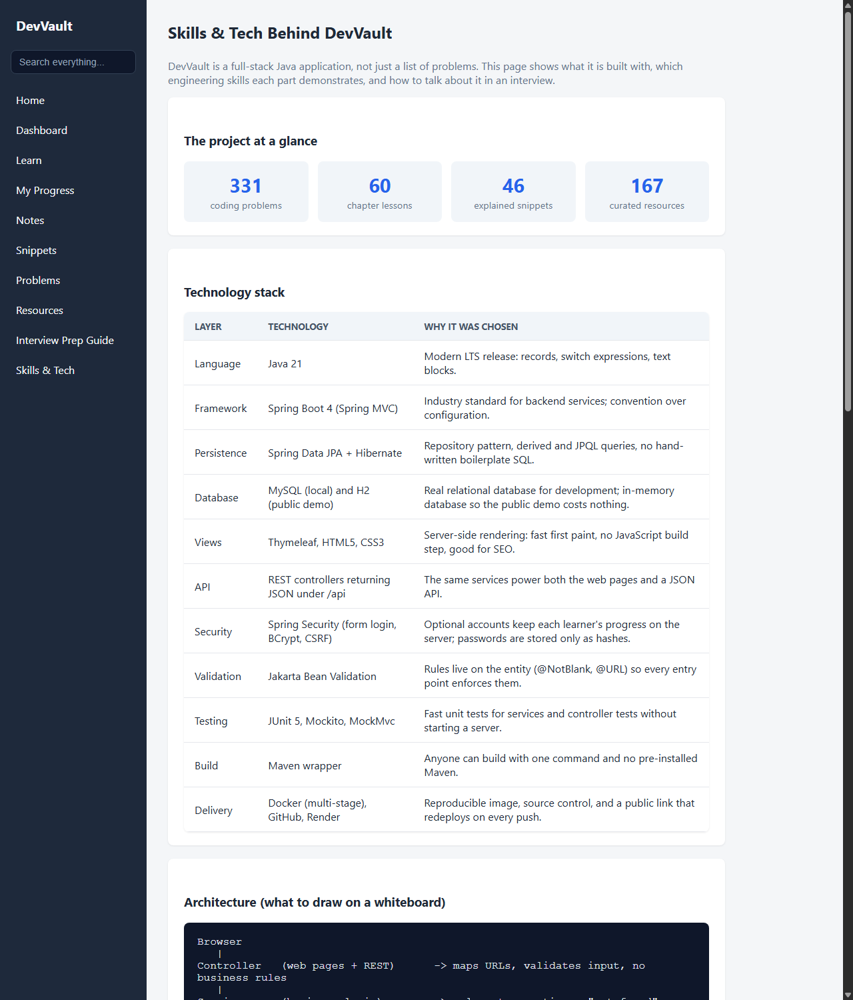

# DevVault

**A full-stack Java learning platform for interview preparation: a 60-lesson learning path, 331 coding problems with line-by-line code explanations, explained snippets, notes, resources and personal progress tracking.**

Built by **Rajesh S M** with Java 21, Spring Boot, JPA/Hibernate, MySQL, Spring Security and Thymeleaf.

**Live demo:** https://devvault-dqkk.onrender.com
(free hosting: the first visit after a quiet period can take a minute or two to wake up; the demo is read-only)



## Why this project exists

Most interview-prep sites show you a solution and stop. DevVault is built around *understanding*:

- **Attempt first.** A problem's pattern hint, explanation and solution unlock only after you submit your own attempt.
- **Every line explained.** Lessons and problems show the code next to a table of "this fragment, and exactly why it is there".
- **What interviewers expect.** Each lesson and problem ends with what interviewers and recruiters look for.
- **Real-website problems.** About 70 problems model features real sites ship: a rate limiter, circuit breaker, idempotent payments, seat booking with a waitlist, search ranking with TF-IDF, consistent hashing and more.

## Screenshots

| Learn path lesson | Problem with line-by-line solution |
|---|---|
|  |  |

| Search across everything | Skills & Tech page for recruiters |
|---|---|
|  |  |

## Features

- **Learn path** (`/learn`): 10 chapters and 60 lessons from "your first program" to system design and behavioural interviews.
- **331 coding problems** (beginner, intermediate, hard) with beginner and optimized solutions, complexity, common mistakes and an interviewer view.
- **45 code snippets in 19 languages**, each with a plain-English *meaning*.
- **40+ revision notes** and **165+ curated resources**.
- **Global search** across lessons, problems, snippets, notes and resources.
- **My Progress:** "Mark as done" on lessons and problems. Stored in the browser when signed out; stored on the server when signed in, with automatic merge on first sign-in.
- **Accounts:** registration and sign-in with BCrypt-hashed passwords, CSRF protection and per-user progress.
- **One-click practice status** (not started / learning / learned / needs revision) feeding the dashboard's "Needs Revision" list.
- **Welcome page extras:** a scroll-driven "tide" animation (water that rises as you scroll), an animated signature and the Sign in / Register buttons. Other pages use a subtle fade-in only. Motion is disabled for visitors who prefer reduced motion.
- **Responsive layout:** the sidebar becomes a swipeable top bar on phones.
- **REST API** under `/api` for notes, problems, resources and snippets, with consistent JSON errors.

## Tech stack

| Layer | Technology |
|---|---|
| Language | Java 21 |
| Framework | Spring Boot 4 (Spring MVC), Spring Security |
| Persistence | Spring Data JPA, Hibernate, MySQL (local) / H2 in memory (public demo) |
| Views | Thymeleaf, HTML5, CSS3, vanilla JavaScript (no build step) |
| Validation | Jakarta Bean Validation |
| Testing | JUnit 5, Mockito, AssertJ, MockMvc, Spring Security Test |
| Build and delivery | Maven wrapper, multi-stage Docker image, GitHub, Render |

## Architecture

```
Browser
   |
Security filter chain  (CSRF, form login, /api/me/** needs a signed-in user)
   |
ReadOnlyFilter         (public demo only: blocks every write except practice, sign-up and own progress)
   |
Controller             (web pages + REST; maps URLs, validates input)
   |
Service                (business rules, not-found handling, transactions)
   |
Repository             (Spring Data JPA queries)
   |
Database               (MySQL locally, H2 in memory for the demo)
```

Seed content (problems, lessons, snippets, notes, resources) is loaded by `ContentSeeder`/`DataSeeder` **before the web server starts accepting requests**, so visitors never see a half-filled library.

### Project layout

```
src/main/java/com/devvault
  config/       security, read-only filter, seeders, current-user advice
  config/seed/  all starter content (problems, lessons, notes, snippets, resources)
  controller/   web and REST controllers
  service/      business logic
  repository/   Spring Data repositories
  entity/       JPA entities
  exception/    NotFoundException + global exception handler
  util/         small helpers (line-by-line parser)
src/main/resources
  templates/    Thymeleaf pages
  static/       CSS and JavaScript
```

## Run it locally

Requirements: JDK 21 and MySQL 8+.

```bash
# 1. create the database and a user (see src/main/resources/application-local.properties.example)
# 2. copy the example file and put your password in it
cp src/main/resources/application-local.properties.example src/main/resources/application-local.properties

# 3. start the app
./mvnw spring-boot:run
```

Open http://localhost:8080. The tables are created automatically and the starter content is loaded on first start.

### Run the public (read-only, in-memory) version with Docker

```bash
docker build -t devvault-cloud .
docker run -p 8080:8080 -e PORT=8080 devvault-cloud
```

### Tests

```bash
./mvnw test
```

92 automated tests cover services (Mockito), controllers (MockMvc, including CSRF and sign-in rules), the seed content (every problem and lesson has its explanation, no duplicates) and the application context.

## Deployment

The `main` branch is deployed to Render from the `Dockerfile` (multi-stage build, JRE-only runtime image). The `cloud` Spring profile switches to an in-memory H2 database and `devvault.readonly=true`. Static CSS and JavaScript URLs carry a content hash, so a new deploy is never hidden behind a stale browser cache.

## Security notes

- Passwords are stored only as BCrypt hashes; length limited to 72 characters (BCrypt's real limit).
- CSRF protection is on for every form and for the progress API.
- All SQL goes through JPA with bound parameters; templates escape output (`th:text`), and stored links are accepted only as same-site paths.
- Secrets live in a git-ignored properties file or environment variables, never in the repository.
- The public demo is read-only: a filter rejects every write except practice attempts, account creation and a signed-in user's own progress.

## Design decisions and honest limitations

- **In-memory database for the public demo.** It costs nothing, but accounts and progress saved on the server disappear when the free host restarts. Run locally with MySQL for permanent data.
- **Server-side rendering** keeps pages fast and simple, with no JavaScript build step; the small amount of JavaScript is progressive enhancement.
- **No login throttling yet** and no e-mail verification or password reset.
- The older REST endpoints (`/api/notes`, `/api/problems`, ...) are intentionally open for API clients; they are not exposed for writes on the public demo.

## Roadmap

- Flyway migrations instead of automatic schema updates.
- Login rate limiting and password reset by e-mail.
- Integration tests with Testcontainers against a real MySQL.
- Roles, so only an admin can edit content in a hosted deployment.

## Author

**Rajesh S M** - designed and built DevVault.
