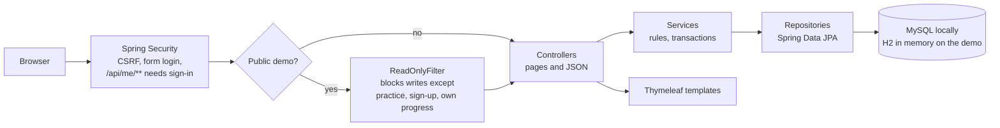
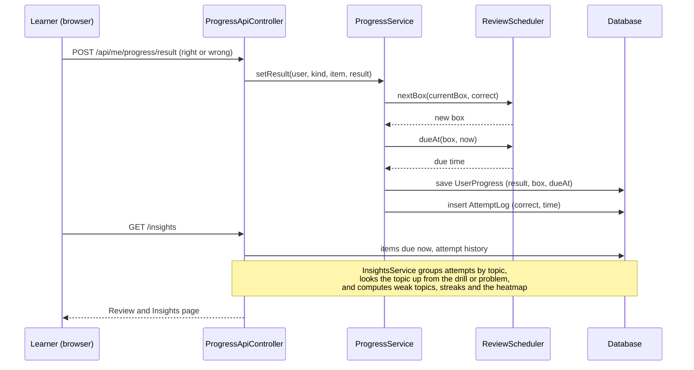
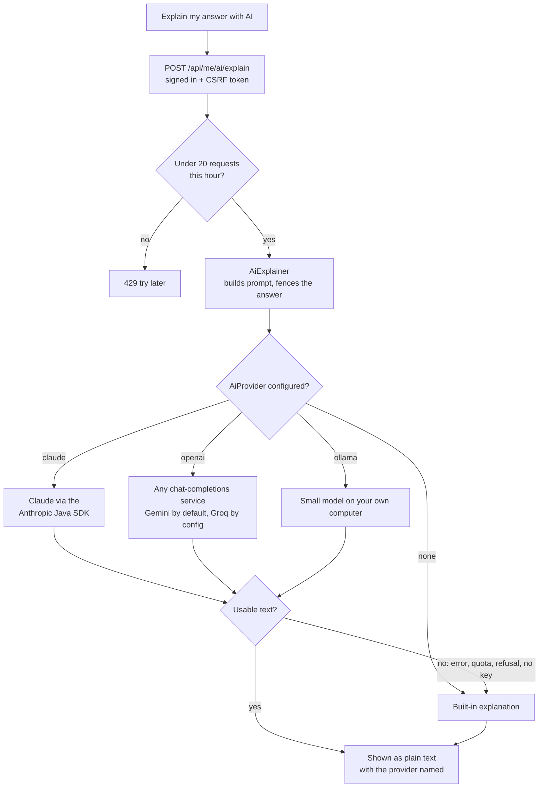
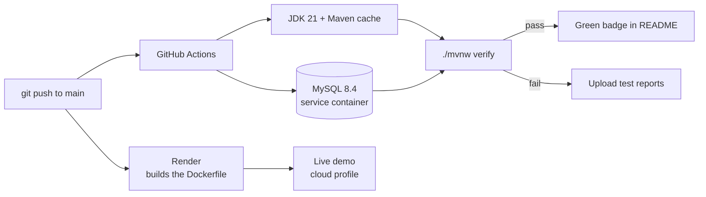

# DevVault architecture

This page explains how DevVault is put together and why. The diagrams are [Mermaid](https://mermaid.js.org/), which GitHub renders directly.

- [1. Request flow](#1-request-flow)
- [2. Spaced repetition and the weakness dashboard](#2-spaced-repetition-and-the-weakness-dashboard)
- [3. The AI explainer](#3-the-ai-explainer)
- [4. Practice drills](#4-practice-drills)
- [5. Testing, CI and deployment](#5-testing-ci-and-deployment)
- [6. Decisions and trade-offs](#6-decisions-and-trade-offs)
- [7. Known limitations](#7-known-limitations)

## 1. Request flow

The same code runs in two modes, chosen by the Spring profile:

| | `local` | `cloud` (public demo) |
|---|---|---|
| Database | MySQL, permanent | H2 in memory, re-seeded on every start |
| Writes | allowed | blocked by `ReadOnlyFilter` except practice, sign-up and the signed-in user's own progress |
| Java code judge | on | off (it runs submitted code) |
| AI provider | whatever you configure | `none` unless you set it |

Starter content (problems, lessons, notes, snippets, resources) is seeded before the web server accepts requests, so a visitor never sees a half-filled library.

## 2. Spaced repetition and the weakness dashboard

Every time a signed-in learner answers a drill or a problem, the answer is saved twice: as the **latest result** of that item and as one row in an **append-only attempt log**. The latest result carries the review schedule. The log feeds the statistics.

**The schedule** is a Leitner system with six boxes. A right answer moves the item up one box, a wrong answer sends it back to box 0.

| Box | 0 | 1 | 2 | 3 | 4 | 5 |
|---|---|---|---|---|---|---|
| Review again after | 1 day | 2 days | 4 days | 8 days | 16 days | 32 days |

**A weak topic** needs at least 3 answers and under 70% correct, so one slip does not label a topic. The current streak survives until the end of today, so it is not lost before you have had the chance to practise.

Design notes:

- The scheduling rules live in one small pure class (`ReviewScheduler`) with no Spring or database dependency, so they are unit tested directly.
- Topics are not stored on the attempt. They are looked up when the page is built, so a drill or problem that is recategorised is reflected immediately and the table stays small.
- Signed-out visitors keep their progress in the browser only, so scheduling and insights need an account. That is deliberate: it keeps the public demo free of anything personal.

## 3. The AI explainer

After a wrong drill answer, a signed-in learner can ask for an explanation written for **their** answer.

Every provider implements one tiny interface, `AiProvider`, and returns an **empty string instead of throwing**. That makes the fallback rule one line in `AiExplainer`: empty text means use the built-in explanation. Spring picks the provider with `@ConditionalOnProperty`, so exactly one (or none) exists at runtime.

Safeguards, because this endpoint can spend money and takes user text:

- **Sign-in and CSRF required**, plus a **per-user limit** (20 requests an hour) so one account cannot run up a bill.
- The learner's answer is **cut to 300 characters**, has angle brackets removed so it cannot close its own tag, and is placed between `<learner_answer>` tags that the system prompt declares to be untrusted data.
- The reply is inserted with `textContent`, never as HTML.
- API keys come only from environment variables, never from the repository.

Provider choice in practice: the hosted free tiers are faster and stronger, a small local model needs no key or internet but takes roughly 30 to 40 seconds on a laptop CPU, and the built-in explanation is always available as the floor.

## 4. Practice drills

There are 10,000 auto-graded drills, but none is stored in the database. `DrillCatalog` builds them deterministically from a set of question **families** (algorithms, Java, application code), each of which generates variants with a computed correct answer. A drill's id (1 to 10,000) is therefore stable, and its answer is checked on the server by `DrillService`, so the right answer is never sent to the page until the learner has tried.

## 5. Testing, CI and deployment

- **Unit tests** cover the scheduler, the weak-topic and streak rules, the rate limiter and the prompt building.
- **Controller tests** use MockMvc with the real security configuration, so they check sign-in, CSRF and status codes, and render the real templates.
- **Provider tests** run against a tiny in-process HTTP server that fakes the AI service, so no key or network is needed, and they cover the error and quota paths.
- **Context tests** start the whole application, one against MySQL (the `local` profile) and one against H2 (the `cloud` profile), which is why CI starts a MySQL container.
- The Docker image is multi-stage: Maven builds the jar, and a JRE-only image runs it. The Java judge needs a JDK, so it stays off in that image.

## 6. Decisions and trade-offs

| Decision | Why | What it costs |
|---|---|---|
| Server-side rendering with Thymeleaf and a little vanilla JavaScript | Fast pages, no build step, nothing for a reviewer to install | Less interactive than a single-page app |
| In-memory H2 on the public demo | Free hosting with a shareable link | Accounts and history vanish on restart |
| Leitner boxes instead of SM-2 | Easy to explain and test, predictable intervals | Less adaptive than a per-item ease factor |
| Attempt log kept separately from the latest result | Accurate accuracy and streak statistics without losing the simple "current state" row | One extra table that grows with use |
| AI behind a one-method interface that never throws | New providers are one small class, and a failure can never break the page | Errors are logged, not shown to the learner |
| Built-in explanation as the permanent fallback | The feature works with no key, no quota and no internet | The "AI" text can be generic |
| Running submitted Java in a separate process, opt-in only | Real judging for local use | Not a full sandbox, so it is off on the public server |
| Hosted AI is opt-in, off by default | The demo costs nothing and cannot be abused for free tokens | Recruiters see the built-in text unless a key is set |

## 7. Known limitations

- No login throttling, e-mail verification or password reset yet.
- Schema changes rely on Hibernate's automatic update rather than migration scripts (Flyway is on the roadmap).
- The AI rate limiter and the attempt history on the demo live in memory, so they reset on restart.
- Review scheduling is not available to signed-out visitors.
- Streaks use the server's time zone, not the learner's.
- The AI explanation can be wrong, and the page says so; the local small model in particular may guess at why a learner made a mistake.
